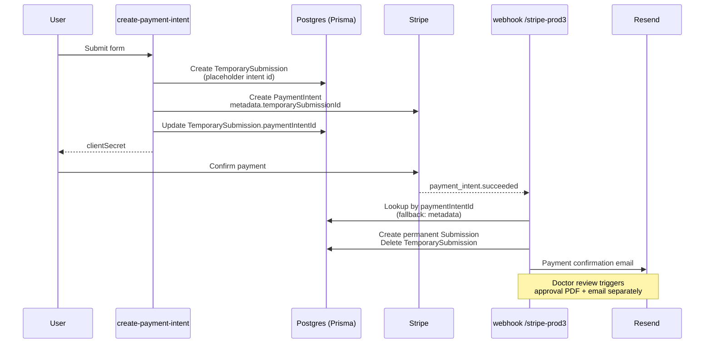

<p align="center">
  <h1 align="center">Online Doctor's Note</h1>
  <p align="center">
    Production Next.js 16 app that issues legitimate medical excuse notes for work or school — multi-step intake, Stripe payments, doctor review, PDF delivery by email.
  </p>
</p>

<p align="center">
  
  
  
  
  
  
  
</p>

---

## Highlights

- **12-step guided intake** — react-hook-form + Zod, conditional guardian flow, localStorage draft persistence.
- **Stripe-first architecture** — `TemporarySubmission` is written _before_ the `PaymentIntent`, with a metadata fallback so webhooks never lose a paid order.
- **Doctor review portal** — Better Auth (bcrypt), Tinder-style card review, search/edit any submission, one-click re-approval that regenerates PDF and email.
- **Medical-grade PDFs** — `@react-pdf/renderer` with Plus Jakarta Sans, state-specific license numbers for 46 states, returned by email on approval.
- **Production-ready** — Prisma Accelerate (40× faster queries), Resend webhook handling for bounces, HIPAA-conscious UX, 369+ tests on PGlite so CI never touches prod.

---

## Tech Stack

- **Framework** — Next.js 16 (App Router + Turbopack), React 19, TypeScript 5 strict
- **UI** — Tailwind CSS 4, shadcn/ui, Radix UI, Lucide icons
- **Forms** — react-hook-form, Zod, date-fns + date-fns-tz
- **Database** — PostgreSQL via Prisma ORM + Prisma Accelerate; PGlite (`@prisma/dev`) for local/CI
- **Auth** — Better Auth (email/password, bcrypt 10 rounds)
- **Payments** — Stripe (API `2026-02-25.clover`) with webhook-driven fulfillment
- **Email** — React Email + Resend; bounce tracking via Resend webhook
- **PDF** — @react-pdf/renderer with @fontsource/plus-jakarta-sans
- **Testing** — Vitest + Testing Library, PGlite per run
- **Analytics** — Google Ads, Reddit Pixel

---

## Architecture

### Form flow

```mermaid
flowchart TD
  A[/start — landing/] --> B[/get-started — state selection/]
  B --> C[/basic-info — patient/]
  C --> D{Recipient?}
  D -- myself --> F[/contact-info/]
  D -- someone_else --> E[/guardian-info/]
  E --> F
  F --> G[/note-purpose/]
  G --> H[/absence-dates/]
  H --> I[/absence-reason/]
  I -- sick / injury / mental --> J[/symptoms/]
  I -- appointment / other --> K[/additional-info/]
  J --> K
  K --> L[/review/]
  L --> M[/payment/ — Stripe]
  M --> N[/approved/]
```

### Payment fulfillment



---

## Quick Start

### Prerequisites

- **Node.js 22** (see `.github/workflows/test.yml`)
- Stripe account + CLI (for local webhooks)
- Resend account (sending API key)
- PostgreSQL for production; local dev uses PGlite (no install needed)

### Install and run

```bash
git clone https://github.com/Data-Buddies-Solutions/onlinedoctornote.git
cd onlinedoctornote
npm install

cp .env.example .env.local
# fill in the values documented below

npx prisma generate
npm run dev
```

Open http://localhost:3000.

---

## Local Development

This project ships with **PGlite** (via `@prisma/dev`) so you don't need a local Postgres installation. Tests spin it up automatically; for manual dev, use the `db:local:*` scripts.

| Command                   | What it does                       |
| ------------------------- | ---------------------------------- |
| `npm run db:local`        | Start PGlite in the foreground     |
| `npm run db:local:detach` | Start PGlite in the background     |
| `npm run db:local:stop`   | Stop the default detached instance |
| `npm run db:local:ls`     | List running local databases       |

Tests use `vitest.global-setup.ts` to start/stop PGlite around the run, so `npm test` is self-contained. CI never sees production credentials.

Full walkthrough: [`docs/LOCAL_DEVELOPMENT_TESTING.md`](docs/LOCAL_DEVELOPMENT_TESTING.md).

### Stripe webhooks locally

```bash
brew install stripe/stripe-cli/stripe
stripe login
stripe listen --forward-to localhost:3000/api/webhooks/stripe-prod3
# copy the displayed whsec_ into STRIPE_WEBHOOK_SECRET
```

---

## Environment Variables

```env
# Site
NEXT_PUBLIC_SITE_URL=http://localhost:3000

# Stripe
STRIPE_SECRET_KEY=sk_test_...
NEXT_PUBLIC_STRIPE_PUBLISHABLE_KEY=pk_test_...
STRIPE_PRICE_ID=price_...
STRIPE_WEBHOOK_SECRET=whsec_...

# Database
DATABASE_URL=postgresql://...              # direct (migrations)
PRISMA_DATABASE_URL=prisma+postgres://...  # Accelerate (runtime)

# Better Auth
BETTER_AUTH_SECRET=...
BETTER_AUTH_URL=http://localhost:3000

# Email (Resend)
RESEND_API_KEY=re_...
RESEND_FROM_EMAIL=noreply@yourdomain.com

# Doctor (PDF)
DOCTOR_NAME="Dr. Your Name"
DOCTOR_CREDENTIALS="MD"
DOCTOR_SIGNATURE_URL="/images/doctor-signature.png"

# Cron
CRON_SECRET=...
```

---

## Project Structure

```
src/
├── app/
│   ├── admin/              # Better Auth-protected review portal
│   ├── api/                # Stripe, auth, webhook, cron routes
│   └── [form-pages]/       # 12 intake steps + /approved + /payment
├── components/
│   ├── admin/              # Review cards, search, status badges
│   ├── form/               # Reusable form inputs (DOB, state select, …)
│   └── ui/                 # shadcn/ui primitives
├── emails/                 # React Email templates
├── lib/
│   ├── validation-schemas.ts
│   ├── date-validators.ts
│   ├── age-validators.ts
│   ├── email-helpers.ts
│   ├── state-licenses.ts
│   └── pdf/                # @react-pdf/renderer template + generator
└── prisma/
    └── schema.prisma
```

---

## Business Rules

- **Absence window** — max 7 consecutive days; first day off can't be more than 7 days in the past. Enforced in `src/lib/date-validators.ts`.
- **Age** — requester or guardian must be 18+ (`src/lib/age-validators.ts`).
- **Monthly soft limit** — 7 approved days per rolling 30-day window, tracked by `patientName + DOB` (case-insensitive). Warning-only; the doctor decides.
- **Pricing** — fetched live from Stripe via `STRIPE_PRICE_ID`. Change it in the dashboard, no deploy needed.
- **State support** — 46 US states have mapped medical licenses in `src/lib/state-licenses.ts`; others fall back gracefully.
- **Scope** — no FMLA, workers' comp, disability, insurance, or legal/court documentation. Requests for these are denied.

---

## Scripts

```bash
# Dev
npm run dev                # Next dev (Turbopack)
npm run email              # Preview email templates
npm run build              # Production build
npm start                  # Run the build

# Database
npx prisma studio          # GUI
npx prisma generate        # Regenerate client
npx prisma db push         # Push schema (dev)
npx prisma migrate dev     # Create migration
npx tsx scripts/create-doctor-user.ts   # Seed an admin

# Testing
npm test                   # Full suite (auto-starts PGlite)
npm run test:ui            # Vitest UI
npm run test:coverage      # Coverage report
npm run test:watch         # Watch mode

# Quality
npm run lint
npm run format
npm run format:check
npx tsc --noEmit
```

---

## Admin Portal

- **`/admin/login`** — Better Auth sign-in
- **`/admin`** — dashboard + stats
- **`/admin/review`** — card-style queue for pending submissions
- **`/admin/search`** — search by name/email/ID; view + edit any submission
- **`/admin/maybe` · `/approved` · `/denied`** — today's queues by status

Approval generates a PDF (blocking) then sends an email (non-blocking). Denial automatically refunds via Stripe and emails the patient. Re-approval of an already-approved submission regenerates a new PDF and sends a fresh email.

---

## Security

- Zod input validation on client and server (TLD whitelist rejects e.g. `.clm`)
- Stripe webhook signature verification
- Better Auth sessions in Postgres, bcrypt 10-round password hashes
- Timing-safe cron secret comparison
- Env var validation on boot
- CSRF (Next.js) and XSS (React escaping) out of the box

---

## Deployment

Deploys to Vercel. Required before going live:

- [ ] Set `NEXT_PUBLIC_SITE_URL` and `BETTER_AUTH_URL` to the production domain
- [ ] Swap to live Stripe keys and configure the webhook endpoint in the Stripe dashboard
- [ ] Confirm `PRISMA_DATABASE_URL` points at the production Accelerate connection string
- [ ] Set `CRON_SECRET` and verify Vercel cron jobs are registered
- [ ] Verify `RESEND_FROM_EMAIL` domain is verified with Resend

---

## Releases

See the [GitHub Releases](https://github.com/Data-Buddies-Solutions/onlinedoctornote/releases) page for version history and changelog.

---

## License

Proprietary — All Rights Reserved. Private repository, not accepting external contributions.
