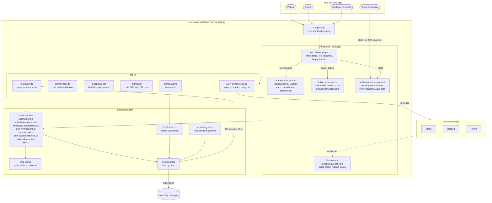
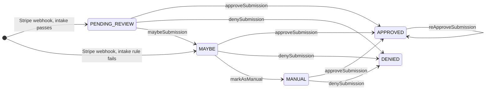
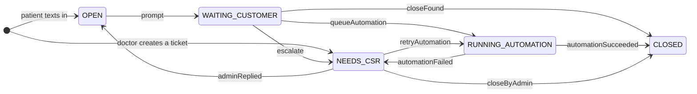

# Online Doctor's Note

Online Doctor's Note (ODN) sells doctor's notes for work or school. A patient answers a short intake, pays with Stripe, and waits for a doctor to review the request. When the doctor approves it, the patient gets an email with the note as a PDF. The note carries a QR code that opens a public page where an employer or a school can check that the note is real.

Staging runs this repo on Cloud Run. Production still runs the old `Data-Buddies-Solutions/onlinedoctornote` repo on Vercel, with Vercel crons, until the cutover in `docs/CLOUD_RUN.md`.

## Who uses it

- **Patients** fill in the intake in English, or in Spanish under `/es`, pay on `/payment`, and get updates by email and, if they opt in, by SMS.
- **Doctors** sign in at `/admin/login` and work the queues under `/admin`. They approve, deny, or set aside each request, and answer SMS support tickets. Every signed-in user has the same rights, because `requireAdminSession` in `src/lib/admin-session.ts` checks only for a session. Public sign-up is off, so a doctor account exists only if someone creates it.
- **Employers and schools** check a note on `/verify` by its QR code or its medical record number. `src/proxy.ts` picks the host from two hardcoded sets in `src/lib/verification-url.ts`. On `phealthclinic.com` it serves only the `/verify` pages. On `onlinedoctornote.com` it redirects `/verify` to `VERIFICATION_BASE_URL`. That variable is only the redirect destination and the base URL of the verification links in notes.

The app depends on these outside services and libraries.

| Service               | What ODN uses it for                                                                                                                                                                                                                                | Code                                                                         |
| --------------------- | --------------------------------------------------------------------------------------------------------------------------------------------------------------------------------------------------------------------------------------------------- | ---------------------------------------------------------------------------- |
| Stripe                | Takes the payment through a payment intent. Its `payment_intent.succeeded` webhook creates the submission. A denial refunds the payment, except a queue denial of a `MANUAL` submission.                                                            | `src/lib/stripe.ts`, `src/app/api/webhooks/stripe-prod3`                     |
| Resend                | Sends the payment confirmation, approval, denial, maybe, and follow-up emails. The approval email has the PDF attached. Its `email.bounced` webhook alerts the team and texts an opted-in patient.                                                  | `src/lib/email.ts`, `src/emails`, `src/app/api/webhooks/resend`              |
| Telnyx                | Sends transactional SMS when `TELNYX_SMS_ENABLED=true`. Its webhook records delivery status and opt-outs, and turns inbound texts into support tickets.                                                                                             | `src/lib/telnyx.ts`, `src/lib/sms-support.ts`, `src/app/api/webhooks/telnyx` |
| better-auth           | Runs doctor login and sessions on the app's own Postgres tables, with bcrypt password hashes.                                                                                                                                                       | `src/lib/auth.ts`, `src/db/auth.ts`, `src/app/api/auth/[...all]`             |
| `@react-pdf/renderer` | Renders the note PDF inside the app process. `qrcode` draws the QR code. Both are libraries, not remote services.                                                                                                                                   | `src/lib/pdf/generate-pdf.tsx`, `src/lib/qr-code.ts`                         |
| Cron scheduler        | Calls the two cron routes every hour with `Authorization: Bearer $CRON_SECRET`. One deletes expired drafts and one sends follow-up emails. On staging the caller is Cloud Scheduler. Production uses the old repo's Vercel crons until the cutover. | `src/app/api/cron`, `docs/CLOUD_RUN.md`                                      |

## Architecture

The app is one Next.js 16 service. Staging runs it on Cloud Run, and the diagram shows that deploy. Browsers reach pages, server actions, and API routes. The providers call back into the webhook routes. Everything that touches Postgres goes through `src/db`.



These are the boundaries an engineer has to respect.

- **Pages and actions.** Each intake step is a page under `src/app`, and the Spanish pages live under `src/app/es/(flow)`. Admin pages call server actions in `src/app/admin/_actions` and `src/app/admin/support/_actions`. Every action is built with `adminAction` from `src/lib/admin-session.ts`, which redirects to `/admin/login` when there is no session.
- **Config.** `src/lib/env.ts` parses every server variable with zod, and `src/lib/public-env.ts` parses the `NEXT_PUBLIC_*` ones. `src/instrumentation.ts` runs the check at startup, so the server exits and names each missing or invalid variable.
- **SDK clients.** Stripe, Resend, and better-auth each have one owner module in `src/lib`, which builds the client the first time a function needs it. Telnyx is called over HTTP from `src/lib/telnyx.ts`.
- **Database.** `src/db` is the only code that talks to Postgres. Callers import named functions from table modules such as `src/db/submissions.ts`, and types from `src/db/types.ts`. Nothing outside `src/db` imports `pg` or the SQL kernel. `src/db/pool.ts` holds one pool of five connections and sends each query as one statement.
- **Status changes.** Two modules in `src/db` own the status columns. `src/db/submission-lifecycle.ts` owns a submission's status and its refund columns. `src/db/sms-support-lifecycle.ts` creates SMS support tickets and their jobs, and it owns a ticket's status, state, and automation status and every change to a job. Each module names its steps and the statuses that each step starts from. It runs a step as one `UPDATE` that matches only a row in one of those statuses, and it returns a typed refusal when the row has moved. The lint rules `local/lifecycle-owner` and `local/sms-lifecycle-owner` flag SQL outside these modules that writes those columns, in the forms that `AGENTS.md` lists.
- **Migrations.** Schema changes are numbered SQL files in `src/db/migrations`. `npm run db:migrate` applies each pending file in its own transaction and stores its sha256, so it refuses a file that changed after it was applied.

## Submission lifecycle

A submission has one of five statuses from `SubmissionStatus` in `src/db/types.ts`. The diagram shows how a submission enters the queue and the steps a doctor takes from the review queues. It follows the transition table in `src/db/submission-lifecycle.ts`, the only module that changes a submission's status after the row is created.



Approving a `PENDING_REVIEW` or `MAYBE` submission issues the PDF and emails it. Approving a `MANUAL` submission records the decision only, with no PDF and no email. `denySubmission` on a `MANUAL` submission sends no email and issues no refund, but it revokes the note. `reApproveSubmission` issues a new PDF and revokes the old one.

Denying a `PENDING_REVIEW` or `MAYBE` submission refunds the payment in three steps. The action reserves the refund on the row, calls Stripe, and then records the refund id. If Stripe refused the refund for certain, the action releases the reservation and the submission goes back to its earlier status. If the outcome is unknown, the submission stays `DENIED` with the refund pending. To settle it, run `npx tsx scripts/settle-refund-reservation.ts <submission id>`. The script records the refund that Stripe holds, or, with `--release-to <status>`, releases the reservation when Stripe holds no refund. If the script and a denial both reach the same refund, only the run that records it sends the denial email. The other run returns the warning "already recorded by another run". A submission that an earlier denial refunded is not refunded again.

From a submission's page under `/admin/search`, `changeSubmissionStatus` can also override the status. A `DENIED` submission whose payment was refunded or is being refunded cannot move out of `DENIED`. Only a denial that issued no refund, such as a `MANUAL` one, can.

| Target           | Allowed from                                                    | Side effects                                                                                                       |
| ---------------- | --------------------------------------------------------------- | ------------------------------------------------------------------------------------------------------------------ |
| `DENIED`         | `PENDING_REVIEW`, `MAYBE`, `MANUAL`, `APPROVED`                 | Refunds the payment if no earlier denial did, revokes the note, emails the patient, and texts an opted-in patient. |
| `MAYBE`          | `PENDING_REVIEW`, `MANUAL`, `APPROVED`, `DENIED` with no refund | Revokes the note. From `PENDING_REVIEW`, a reason that sends email also emails and texts the patient.              |
| `MANUAL`         | `PENDING_REVIEW`, `MAYBE`, `APPROVED`, `DENIED` with no refund  | Revokes the note.                                                                                                  |
| `PENDING_REVIEW` | `MAYBE`, `MANUAL`, `APPROVED`, `DENIED` with no refund          | Clears the reviewer and revokes the note.                                                                          |

## SMS support tickets

A patient who texts the support number gets a support ticket. The app answers from a menu of support topics. It can fix some problems on its own, and it hands the rest to a person at `/admin/support`. A ticket has one of five statuses from `SMS_SUPPORT_STATUS` in `src/lib/sms-support-types.ts`. The diagram shows the usual path through the steps in `src/db/sms-support-lifecycle.ts`. Some steps also start from statuses that the diagram leaves out, and the list after the diagram names them.



- **Conversation steps.** `prompt`, `closeFound`, `escalate`, and `queueAutomation` each start from `OPEN`, `WAITING_CUSTOMER`, or `NEEDS_CSR`. Each step also pins the status that the inbound text read. If another text moved the ticket first, the module refuses the step, and the app handles the losing text again from the new status, up to three attempts in all.
- **Automation.** `queueAutomation` runs when a patient asks to change the date of birth or the purpose on an approved note. `startAutomation` runs that step and creates a job in `sms_support_jobs` in one transaction, and the app runs the job in the same request. The job moves from `QUEUED` to `RUNNING` to `COMMITTING`, and then to `SUCCEEDED` or `FAILED`. A job that succeeds updates the submission and emails the patient a new PDF, and `automationSucceeded` closes the ticket. A doctor can retry a failed automation with `retryAutomation`.
- **Doctor steps.** `adminReplied` moves a ticket to `OPEN`, `closeByAdmin` closes it, and `returnToCsr` moves it to `NEEDS_CSR`. These three steps start from any status. They cancel the ticket's queued and running jobs. The module refuses them while a job is in `COMMITTING`, because that job has already changed the submission.
- **Failures.** A support reply that fails to send (`replyFailed`), a doctor's reply that fails to send (`adminReplyFailed`), and a failed automation (`automationFailed`) move the ticket to `NEEDS_CSR` from any status.

## How a request flows

This is one paid request, from the first form to the PDF in the patient's inbox.

1. **Intake.** The patient walks the pages in `INTAKE_STEPS` in `src/lib/intake.ts`, from `/get-started` to `/review`. The same table drives the progress bar and the back links. `/guardian-info` shows only for a note about someone else, and `/symptoms` is skipped for some absence reasons. Each page checks its fields with its step schema in `src/lib/validation-schemas.ts`, and `src/lib/form-storage.ts` keeps the draft in the browser's local storage.
2. **Checkout.** `/review` leads to `/approved` and then to `/payment`. `src/app/payment/page.tsx` posts the draft to `src/app/api/create-payment-intent/route.ts`. That route runs `parseIntake`, which uses the same schemas as the pages. A draft that cannot be stored gets a 400. A failure of an `always` rule in `src/lib/intake-rules.ts`, such as an under-18 patient, blocks checkout. A failure of a `flag` rule, such as `state_unsupported`, blocks checkout only when `INTAKE_VALIDATION_ENFORCED=true`. Otherwise the route logs it and goes on. The route then saves the draft with `createTemporarySubmission` and creates the Stripe payment intent, with the draft's id in the intent's metadata.
3. **Payment.** The browser confirms the card with Stripe Elements. `/payment/success` reads the result from `src/app/api/verify-payment/route.ts` for conversion tracking.
4. **Webhook.** Stripe calls `src/app/api/webhooks/stripe-prod3/route.ts` with `payment_intent.succeeded`. The route checks the signature, finds the draft by payment intent or by the metadata id, parses it again, and calls `insertSubmission`. A clean draft becomes `PENDING_REVIEW`. A draft that fails a rule becomes `MAYBE` with the reasons in its internal note. A repeated delivery finds the existing submission and returns 200. The route returns a 500, so that Stripe retries, when the draft is missing, cannot be stored, or fails to insert, and on any unexpected error. The route then sends the payment confirmation email and, to an opted-in phone, an SMS.
5. **Review.** A doctor opens `/admin/review`, which loads the queue through `getSubmissionsForReview` in `src/app/admin/_actions/queues.ts`.
6. **Note PDF.** `approveSubmission` in `src/app/admin/_actions/approve.ts` creates a note verification with a medical record number and a slug. It renders the PDF with `generateDoctorNotePDF` from `src/lib/pdf/generate-pdf.tsx` and moves the submission to `APPROVED`. If another doctor changed the submission first, the update matches no row and the action revokes the new verification.
7. **Email.** `sendApprovalEmail` in `src/lib/email.ts` sends the PDF and the verification link through Resend. The action then records the send time and texts an opted-in patient. If the email fails, the approval stays and the doctor sees a warning.
8. **Afterwards.** Every hour, `src/app/api/cron/send-note-follow-ups/route.ts` sends the follow-up emails that are due, and `src/app/api/cron/cleanup-temp-submissions/route.ts` deletes expired drafts. Anyone with the note can open its page at `/verify/[slug]`, served by `src/app/verify/[slug]/page.tsx`.

## Guardrails for agents

`AGENTS.md` lists every rule for changes to this repo and the check that enforces each one. CI runs `npm run check` on every pull request. These rules affect most changes:

- Code has no comments.
- Only `src/db` talks to Postgres.
- Server code reads env vars only through `src/lib/env.ts` and `src/lib/public-env.ts`.

## Develop locally

You need Node 22 and a Postgres database you can reach.

1. Install the dependencies.

   ```bash
   npm install
   ```

2. Copy the example env file, then fill in `.env.local`.

   ```bash
   cp .env.example .env.local
   ```

3. Create the schema in the database that `DATABASE_URL` names.

   ```bash
   npm run db:migrate
   ```

4. Create a doctor account. The script reads `DATABASE_URL`, `ADMIN_EMAIL`, `ADMIN_NAME`, and `ADMIN_PASSWORD` from the shell, not from `.env.local`.

   ```bash
   npx tsx scripts/create-doctor-user.ts
   ```

5. Start the dev server on port 3000.

   ```bash
   npm run dev
   ```

6. To receive Stripe webhooks, run `stripe listen --forward-to localhost:3000/api/webhooks/stripe-prod3` and put the printed `whsec_` value in `STRIPE_WEBHOOK_SECRET`.

Before you push, run `npm run check`. It runs Prettier, ESLint, the suppression check, the TypeScript compiler, the comment check, the doc reference check, the database test check, and Vitest. CI runs the same command.

To run part of the tests, use `npm run test:unit` for the tests that need no database, or `npm run test:db` for the database tests. The database tests start an in-memory PGlite and build it from the files in `src/db/migrations`, so they need no Postgres. Set `TEST_DATABASE_URL` to run them against a real Postgres instead. That URL must point at localhost and name a database that ends in `_test`, because the tests empty every table before each test.

### Environment variables

`src/lib/env.ts` defines each server variable and `src/lib/public-env.ts` defines the two public ones. `.env.example` lists them all with placeholder values.

| Group          | Variables                                                                                                                                                                                                               |
| -------------- | ----------------------------------------------------------------------------------------------------------------------------------------------------------------------------------------------------------------------- |
| Database       | `DATABASE_URL`                                                                                                                                                                                                          |
| Stripe         | `STRIPE_SECRET_KEY`, `STRIPE_WEBHOOK_SECRET`, `STRIPE_PRICE_ID`. The offer prices `STRIPE_FRIENDS_FAMILY_PRICE_ID` and `STRIPE_DOCTOR_10_PRICE_ID` are optional.                                                        |
| Resend         | `RESEND_API_KEY`, `RESEND_WEBHOOK_SECRET`, `RESEND_FROM_EMAIL`                                                                                                                                                          |
| Telnyx         | `TELNYX_SMS_ENABLED`. When it is `true`, also `TELNYX_API_KEY` and `TELNYX_FROM_NUMBER`. The webhook is on by default and rejects every event without `TELNYX_PUBLIC_KEY`. `TELNYX_WEBHOOK_ENABLED=false` turns it off. |
| Auth and crons | `BETTER_AUTH_SECRET`, `BETTER_AUTH_URL` (the app's own origin), `CRON_SECRET`                                                                                                                                           |
| Note content   | `DOCTOR_NAME`, `DOCTOR_CREDENTIALS`, `DOCTOR_SIGNATURE_URL`, `DOCTOR_NPI` (has a built-in default), `VERIFICATION_BASE_URL` (the host in QR codes and verification links)                                               |
| Intake         | `INTAKE_VALIDATION_ENFORCED`, `false` when unset                                                                                                                                                                        |
| Public         | `NEXT_PUBLIC_SITE_URL`, `NEXT_PUBLIC_STRIPE_PUBLISHABLE_KEY`. These two are the only ones `next build` needs.                                                                                                           |

Generate `CRON_SECRET` with `openssl rand -hex 32` and `BETTER_AUTH_SECRET` with `openssl rand -base64 32`.

## Deploy

Staging runs this repo on Cloud Run. Every push to `main` deploys it through `.github/workflows/deploy-staging.yml` and `cloudbuild.yaml`, which run the migration runner before they deploy the new revision. Cloud Scheduler calls its cron routes.

Production does not run this repo yet. It runs the old `Data-Buddies-Solutions/onlinedoctornote` repo on Vercel, and Vercel's crons call its cron routes. `docs/CLOUD_RUN.md` covers the staging deploy, the crons, production migrations, and the cutover that moves production to Cloud Run.

## Repository layout

- `.github/workflows` has CI, the staging deploy, and the production migration workflow.
- `docs` has the Cloud Run runbook and the attribution and purchase tracking notes.
- `eslint-rules` has the repo's own ESLint rules and their tests.
- `public` has static images and `llms-full.txt`.
- `scripts` has the checks that `npm run check` runs, the migration entry point, and one-off maintenance scripts.
- `src` has the app.
  - `src/app` has the pages, the admin server actions, and the API routes.
  - `src/components` has the React components for the intake, the admin portal, and the marketing pages.
  - `src/db` has the database code, the migrations, and the database tests.
  - `src/emails` has the React Email templates.
  - `src/lib` has the domain logic, the env parser, and the SDK owner modules.
  - `src/locales` has the Spanish strings.

## License

Proprietary. All rights reserved.
